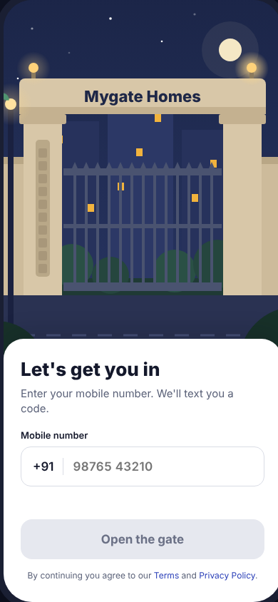
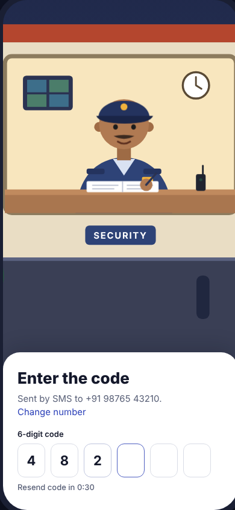
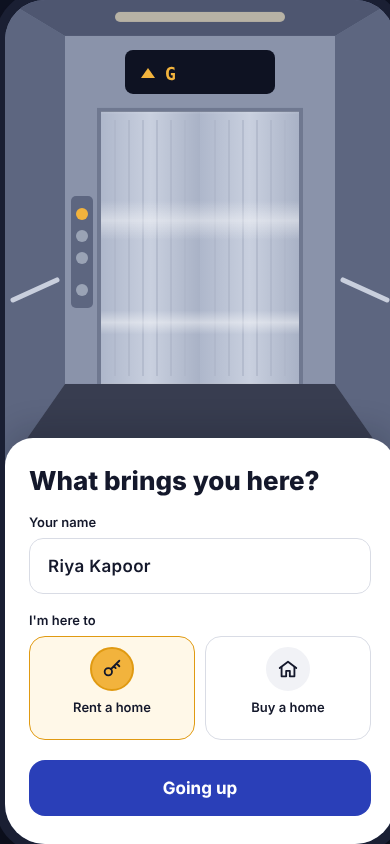
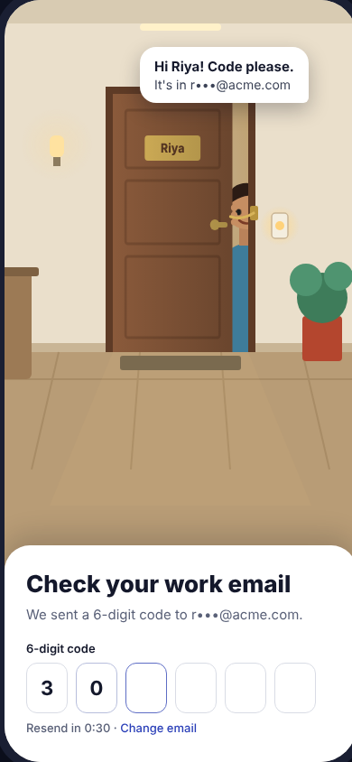
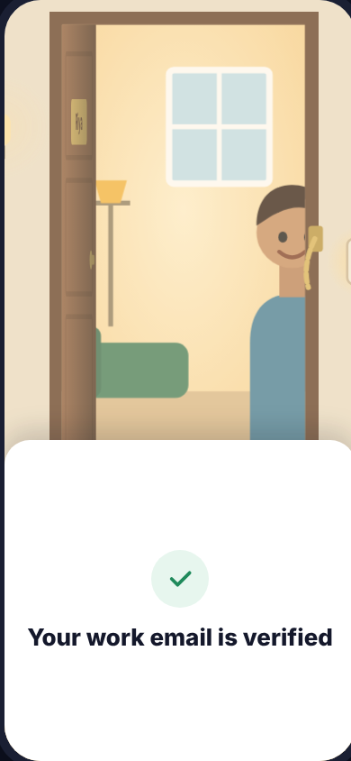

# Mygate Homes — walk-in onboarding

Sign-up for the new Mygate Homes app, told as one continuous walk into a gated society. Your mobile number opens the **gate**, the **guard** checks your OTP, the **lift** takes your name and whether you want to rent or buy, and your **front door** opens on its security chain until your work email is verified. Then the door swings open and you're in.

This repo holds a working, animated prototype of that flow, the build spec, and everything needed to restyle it to Mygate's brand and hand it to engineering.

<p>





</p>

## Try it

No build step. Open `prototype/index.html` in Chrome, or serve the folder:

```bash
python3 -m http.server 8000 --directory prototype
# then open http://localhost:8000
```

Type into the phone as a user would, or press **Autoplay**. The side panel switches between the three user types (non-Mygate user, Mygate resident, returning user) and turns on **Reduced motion**. Test codes: `000000` is always wrong; anything else is accepted. Personal emails such as gmail.com are rejected.

## What's in here

```
prototype/
  index.html        the phone, the four illustrated scenes (inline SVG) and the form card
  css/theme.css     every colour and font, as named tokens  ← restyle here
  css/app.css       layout of the form card, bubble and side panel
  js/motion.js      every duration, easing and parallax factor
  js/engine.js      camera, parallax and tweening
  js/flow.js        the 13 animation beats, form logic, mock API, autoplay
docs/
  spec.md           build spec: flow, branch rules, API contracts, motion, edge cases,
                    analytics, acceptance criteria, Claude Code prompt, open questions
  STYLE-GUIDE.md    how to bring the look to Mygate's brand, and what must not change
  frames/           reference screenshots of each key moment
tests/
  smoke_test.py     plays every flow headless; fails if anything breaks
.github/workflows/  runs the smoke test on every push and pull request
```

## Decisions already made

- Demand only: the lift offers **Rent a home** and **Buy a home**. No owner or listing flow.
- Work email is mandatory for every non-Mygate user. No skip, no "do this later", no visitor mode.
- Mygate residents and returning users never see the work-email step.
- No step counter or scene label on any screen.
- The last screen is a single centred check and "Your work email is verified" (residents and returning users see "Welcome home, {name}"), held 1.5 s, then the app.
- Built in code (SVG art + a small animation engine). No Rive, Lottie or 3D engine, so no motion designer is needed.
- The brand is written "Mygate", lowercase g, everywhere.

Open questions are listed at the end of [`docs/spec.md`](docs/spec.md).

## If you're restyling it to Mygate's look

Read [`docs/STYLE-GUIDE.md`](docs/STYLE-GUIDE.md). In short: change colours and fonts in `prototype/css/theme.css`; redraw art in `prototype/index.html` but keep the element ids and pivots the animation uses; leave `js/motion.js` timings alone unless agreed.

## If you're building it into the app

Follow the "Instructions for Claude Code" section of [`docs/spec.md`](docs/spec.md). It contains the build order and a ready-to-paste Claude Code prompt that points at the files in this repo.

## Workflow

1. Create a branch.
2. Make your change and check it in the browser.
3. Run the smoke test and refresh the reference frames:
   ```bash
   pip install -r tests/requirements.txt
   python -m playwright install chromium
   python tests/smoke_test.py --frames
   ```
4. Commit, including the updated `docs/frames/`, and open a pull request. The same test runs automatically on GitHub.
