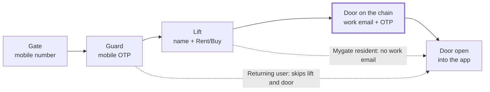

# Mygate Homes App — Society Walk-in Onboarding: Build Spec

Nov 19, 2026 · @Joseph Brendon

Replace the form-based sign-up in the new Mygate Homes app with one continuous camera take through a society: the gate opens on a valid mobile number, the guard lets you in on OTP, the lift takes your name and intent, and your home's door opens on the chain until the work email is verified. Work email is mandatory for every non-Mygate user; there is no skip and no visitor mode. Animation never blocks input or adds wait time.

## Goal and scope

The walk-in turns the existing sign-up rules into a story the user already knows from living in a gated society. Every scene maps to one verification step, so the metaphor carries the logic instead of hiding it.

| Scene | Real-world beat | Product step | Gate to advance |
| --- | --- | --- | --- |
| 1. Gate | Arrive at the society gate | Mobile number entry | Valid 10-digit Indian mobile; `send-otp` succeeds |
| 2. Guard | Guard checks you at the cabin | Mobile OTP | OTP verified; account looked up |
| 3. Lift | Ride up to your floor | Name + intent (Rent / Buy) | Name valid; intent picked |
| 4. Door, on the chain | Ring the bell; door opens on the security chain, someone peeps out | Work email entry + email OTP (every non-Mygate user, mandatory) | Email domain allowed; `send-email-otp` succeeds |
| 5. Door open | Chain comes off, door swings open, home inside | Email OTP verified; user lands in app | Session created; profile complete |

**In scope:** mobile and email OTP screens, branch logic for Mygate residents, non-Mygate users and returning users, all scene animations, error and recovery states, reduced-motion fallback, analytics, feature flag and A/B harness.

**Out of scope:** LinkedIn sign-in (see open questions), paywall and Homes Pro, any owner or listing flow (the app is demand-only), any change to the backend verification rules. This spec reuses the November 2026 sign-up decisions as they stand.

**Design principles**

1. The keyboard and the input field are available the moment a scene appears. Animation plays behind or above the form, never in front of it.
2. A scene advances only after its API call succeeds. The gate never opens on a number that then fails.
3. Each beat uses the prototype's `MOTION` timings. A first-time user waits about 4.3 s in total for the next field to become usable across the whole flow, then sees a 4.7 s door-opening finale. A returning user reaches the app about 4.3 s after OTP is verified, including the 1.5 s hold.
4. Verification state is visible in the world: unverified = door on the chain. That is the user's only cue for why the second OTP exists.

## Flow at a glance



The segment returned at the guard decides the route: returning users cut from the guard to the open door, Mygate residents skip the chain, and every non-Mygate user must verify a work email to get through the door.

## Segments and branch rules

The branch is decided once, by the `verify-otp` response in Scene 2. Everything after reads from `account.segment`.

| Segment (`account.segment`) | How detected | Scenes shown | Must verify | User record created when | Guard line (Scene 2 exit) | Door state (Scene 4–5) |
| --- | --- | --- | --- | --- | --- | --- |
| `RETURNING` | Homes profile already complete | 1 → 2 → 5 | Mobile OTP | Already exists | "Welcome back, {first\_name}." | Opens immediately, no chain |
| `MYGATE_RESIDENT` | Mobile mapped to an active Mygate flat | 1 → 2 → 3 → 5 | Mobile OTP | After Scene 3 | "Good to see you, {first\_name}. Going up to {tower}-{flat}?" | Nameplate shows their flat; opens with no chain |
| `NON_MYGATE` | No active flat; intent = Rent or Buy | 1 → 2 → 3 → 4 → 5 | Mobile OTP + work email OTP | After work email OTP | "First time here? Let me sign you in." | On the chain until email OTP passes |

**Rules**

- Work email is mandatory for every non-Mygate user. No skip, no "do this later", no browse-only or visitor mode. A user who cannot verify a work email does not get past Scene 4.
- Email verification is OTP only. No magic links.
- Mygate residents and returning users never see the work email step.
- A Mygate number with no active flat is treated as non-Mygate. Prefill the name from the Mygate profile if present; never say "you're not a Mygate user".
- Allowed work-email domains: exclude personal providers, real-estate and broker domains, and every domain of a competitor group. Reuse the existing domain classifier; do not rebuild it in the app.

## Scene-by-scene spec

Every scene has the same layout: the illustrated world fills the screen and a native form card is docked at the bottom. The card carries no step counter and no scene label (no "Step 2 of 4", no "At the gate"); it starts directly with the heading. When the keyboard opens, the world compresses to the space left above the card (minimum 180 pt) and keeps playing. All copy below is draft; legal reviews the Scene 4 privacy line.

### Scene 1 — Gate (mobile number)

- **Stage:** society entrance with a "Mygate Homes" arch, closed sliding gate, boom barrier, guard cabin small on the right. A 10-segment light strip on the gate pillar is the progress indicator.
- **Card:** heading "Let's get you in". Sub "Enter your mobile number. We'll text you a code." Field with fixed `+91` prefix, numeric keypad, auto-focus. CTA "Open the gate" (disabled until 10 digits). Consent line under CTA: "By continuing you agree to our Terms and Privacy Policy."
- **Autofill:** Android Phone Number Hint API on focus; iOS `textContentType=telephoneNumber`.
- **Animation:** Motion direction beats 1–3 (idle arrival, a pillar segment per digit, gate opens and the camera dollies through). Invalid number: gate rattles 300 ms, strip turns red.
- **API:** `POST /auth/otp/send` with `{mobile, channel: "sms"}` → `{request_id, otp_length, resend_after_s}`.
- **Errors:** invalid number → "Enter a valid 10-digit mobile number." Rate limited → barrier stays down, "Too many attempts. Try again in {mm:ss}." Network → "Couldn't reach the gate. Check your connection and retry."

### Scene 2 — Guard (mobile OTP)

- **Stage:** close-up of the guard cabin. The guard holds a register and speaks in a speech bubble.
- **Card:** guard bubble "Code please. I sent it to +91 98•••• 4321." OTP boxes, count from `otp_length`, styled as register lines. Auto-submit on the last digit. "Resend code in 0:30" then "Resend code". "Change number" link walks the camera back to the gate (reverse transition, 400 ms).
- **Autofill:** Android SMS Retriever API (app hash in the SMS); iOS `textContentType=oneTimeCode`.
- **Animation:** Motion direction beats 4–6 (guard's eyes follow the OTP boxes, head tilt on a wrong code, folded arms on lockout, nod and boom lift on approval).
- **Exit line by segment:** see the segments table. Line shows for 900 ms, then the camera walks through the lobby to the lift.
- **API:** `POST /auth/otp/verify` with `{request_id, otp}` → `{temp_token, account: {segment, first_name?, flats[], profile_complete}}`.
- **Returning users:** skip the lobby and lift; cut straight to Scene 5 with the door already opening.

### Scene 3 — Lift (name and intent)

- **Stage:** inside the lift. A floor display above the doors; the form is drawn as the lift's button panel.
- **Card:** heading "What brings you here?" Name field (prefilled and editable for Mygate residents). The floor display shows "Hi, {name}" live as they type. Two large floor buttons, single select: "Rent a home", "Buy a home". CTA "Going up".
- **Validation:** name 2–50 characters after trim; letters, spaces, `.` `'` `-` only.
- **Animation:** Motion direction beats 7–9 (step into the lift, display types the name, intent button lights, odometer ascent, ding).
- **API:** `PATCH /onboarding/profile` with `{name, intent}`. For `MYGATE_RESIDENT` this creates the Homes user. For `NON_MYGATE` the server holds it as a draft against `temp_token` until the work email is verified.

### Scene 4 — Door on the chain (work email)

- **World:** corridor, front door. The nameplate engraves "{first\_name}" letter by letter as the user arrives. A doorbell sits to the right of the door.
- **Card, step A:** heading "One last check at the door". Sub "Enter your work email. We use it only to confirm you're a genuine home seeker, never to contact your employer." Email field, `keyboardType=email`. CTA "Ring the bell". No secondary option: no "No work email?", no "Do this later", no skip.
- **Live domain check on blur:** allowed → doorbell glows. Personal provider → inline "That looks like a personal email. Use the one you use at work." Blocked domain → "We can't accept this email domain." Do not explain why a domain is blocked.
- **Card, step B (after send):** door opens to the length of its security chain; the resident peeps out. Bubble: "Hi {first\_name}! Code please. It's in {m•••@company.com}." Heading "Check your work email". Sub "We sent a 6-digit code to {m•••@company.com}." OTP boxes, same component as Scene 2. Below the boxes: "Resend in 0:30 · Change email". "Change email" closes the door to the latch and returns to step A.
- **Animation beats:** see Motion direction, beats 10–13.
- **API:** `POST /auth/email/check` on blur; `POST /auth/email-otp/send` with `{email, temp_token}` → `{request_id, otp_length, resend_after_s}`; `POST /auth/email-otp/verify` → `{user_id, access_token, refresh_token}`.

### Scene 5 — Door open (done)

- **World:** the chain slides off, the door swings fully open, warm light floods out, the resident waves; the camera pushes through the doorway into the living room.
- **Card:** a single centred message, no bullets, no button. Non-Mygate users: a green check and "Your work email is verified". Mygate residents and returning users: "Welcome home, {first\_name}".
- **Hold:** 1.5 s after the text lands, then crossfade into the app. No tap needed.
- **Landing:** deep-linked listing if the user arrived from one; otherwise Home filtered by intent (Rent or Buy).

## State machine and API contracts

One flow-level state machine owns the scene, the form data and the animation inputs. Scenes are views of that machine; they never call each other. Persist the machine's context (minus OTPs) to secure storage after every successful API call so an app kill resumes at the last completed scene for up to 15 minutes.

```typescript
type Segment = 'RETURNING' | 'MYGATE_RESIDENT' | 'NON_MYGATE';
type Intent = 'RENT' | 'BUY';   // demand only; no owner/listing intent

type Scene = 'GATE' | 'GUARD' | 'LIFT' | 'DOOR_CHAINED' | 'DOOR_OPEN';

interface OnboardingContext {
  mobile?: string;                 // 10 digits, no +91
  mobileRequestId?: string;
  tempToken?: string;              // from verify-otp, short-lived
  segment?: Segment;
  firstName?: string;
  flatLabel?: string;              // Mygate residents: shown on the nameplate
  name?: string;
  intent?: Intent;
  workEmail?: string;
  emailRequestId?: string;
  deepLink?: string;               // listing the user came from, if any
  attempts: { mobileOtp: number; emailOtp: number };
  lockedUntil?: number;            // epoch ms
}

// Transitions (event -> next scene). Anything not listed is ignored.
// There is no transition out of DOOR_CHAINED except EMAIL_OTP_OK or going back.
// GATE          OTP_SENT                        -> GUARD
// GUARD         OTP_OK & segment=RETURNING      -> DOOR_OPEN
// GUARD         OTP_OK & otherwise              -> LIFT
// GUARD         CHANGE_NUMBER                   -> GATE
// LIFT          PROFILE_SAVED & MYGATE_RESIDENT -> DOOR_OPEN
// LIFT          PROFILE_SAVED & NON_MYGATE      -> DOOR_CHAINED
// DOOR_CHAINED  EMAIL_OTP_OK                    -> DOOR_OPEN
// DOOR_CHAINED  BACK                            -> LIFT
// DOOR_OPEN     HOLD_DONE (1.5 s)               -> exit to app
```

| Endpoint | Request | Success response | Error codes the client must handle |
| --- | --- | --- | --- |
| `POST /auth/otp/send` | `mobile`, `channel` | `request_id`, `otp_length`, `resend_after_s` | `INVALID_MOBILE`, `RATE_LIMITED` (+`retry_after_s`), `BLOCKED_NUMBER` |
| `POST /auth/otp/verify` | `request_id`, `otp` | `temp_token`, `account{segment, first_name, flats[], profile_complete}` | `OTP_INVALID` (+`attempts_left`), `OTP_EXPIRED`, `LOCKED` (+`retry_after_s`) |
| `PATCH /onboarding/profile` | `name`, `intent`, `flat_id?` | `segment` (unchanged) | `NAME_INVALID`, `TOKEN_EXPIRED` |
| `POST /auth/email/check` | `email` | `verdict: ALLOW \| PERSONAL \| BLOCKED` | none beyond network |
| `POST /auth/email-otp/send` | `email`, `temp_token` | `request_id`, `otp_length`, `resend_after_s` | `DOMAIN_PERSONAL`, `DOMAIN_BLOCKED`, `EMAIL_IN_USE`, `RATE_LIMITED` |
| `POST /auth/email-otp/verify` | `request_id`, `otp` | `user_id`, `access_token`, `refresh_token` | `OTP_INVALID`, `OTP_EXPIRED`, `LOCKED` |

Endpoint paths are placeholders. Claude Code must map them to the real auth service routes before wiring; if a route does not exist, stub it behind a `mockAuth` flag and list the gap in the PR.

## Motion direction: one continuous take, built in code

The onboarding is one unbroken camera move from the street to the living room, and it is built entirely in code. There is no Rive file and no motion designer. The motion prototype in the repo's `prototype/` folder is the finished design: the art is inline SVG in `prototype/index.html`, every colour is a token in `prototype/css/theme.css`, and every duration, easing and parallax factor lives in the `MOTION` object in `prototype/js/motion.js`. Claude Code ports it into the app.

### Why code, not Rive or 3D

| Option | What it needs | Verdict |
| --- | --- | --- |
| **Code-native world** (SVG art drawn by the app's 2D canvas library, animated on the UI thread) | Nothing beyond Claude Code; art and timing already exist in the prototype | **Chosen** |
| Rive | A motion designer working in the Rive editor; Claude Code cannot author `.riv` files | Rejected: no designer |
| Real-time 3D (Three.js / React Three Fiber, Unity, Spline) | 3D artist, extra GL engine, larger binary, slower cold start on low-end Android | Rejected |
| Lottie or pre-rendered video | Fixed clips; cannot react to typing or wrong codes | Rejected |

**How it reads as one take:** each set change is hidden inside the fastest part of a camera push (through the gateway, the lobby doors, the lift doors). The next set crossfades in during that push and settles from a slight zoom, so the eye never sees a cut.

### Storyboard (timings are the prototype's `MOTION` values)

| Beat | Trigger | Camera | World and characters |
| --- | --- | --- | --- |
| 1. Arrival | App opens | Idle | Lamps breathe, stars twinkle, tower windows switch on one by one, a leaf drifts across the foreground |
| 2. Typing the number | Each digit | Zoom +1% per digit | One pillar segment lights per digit; all turn green at 10 valid digits |
| 3. Gate opens | `send-otp` success | Dolly through the gateway to 2.8× in 1000 ms (ease-in), cabin crossfades in at 55%, then settles from 1.18× in 700 ms | Gate slides on its rail, 650 ms with overshoot; light haptic |
| 4. Guard waits | Cabin reached | Static, tilt parallax | Bubble "Code please. I sent it to +91 98••• ••210."; guard writes in the register; his eyes follow the OTP box being filled |
| 5. Wrong OTP / lockout | `OTP_INVALID` / `LOCKED` | None | Head tilt and frown, 420 ms; boxes shake; error haptic. Lockout: arms folded, cabin light dims, countdown on the card |
| 6. Approved | `verify-otp` success | Pans 415 px to Tower B in 900 ms, then pushes through the glass doors to 2.4× in 650 ms | Segment line in the bubble, double nod (350 ms), 900 ms hold; boom barrier lifts (450 ms); glass doors part (380 ms) |
| 7. Into the lift | Push ends | Settles 1.12× → 1× | Lift doors close behind, 600 ms |
| 8. Name and intent | Typing, taps | Static | Display reads "Hi, {first\_name}" live; the chosen intent's button lights on the panel |
| 9. Ascent | Profile saved | Micro-shake (±1.4 px) | Floor counter G → 12 over 1100 ms; light bands slide down the doors; ding ring 500 ms; light haptic |
| 10. Corridor | Lift arrives | Doors open 450 ms; push to 1.9× in 700 ms; corridor settles from 1.15× | Nameplate engraves {first\_name}, 700 ms; doorbell glows once the email domain is allowed |
| 11. Door on the chain | `send-email-otp` success | Static | Bell ripple 500 ms; two footstep haptics; door swings to 28° with overshoot (600 ms); chain pulls taut; fingers on the door edge; resident peeks in (450 ms); bubble "Hi {first\_name}! Code please."; her eyes follow the boxes |
| 12. Wrong email OTP | `OTP_INVALID` | None | Resident squints and frowns; chain rattles 400 ms; error haptic |
| 13. Door opens | `verify-email-otp` success | Push to 1.8× in 900 ms while warm light washes the frame | Chain drops (500 ms); success haptic; door swings to 82° (900 ms); interior light spills onto the corridor floor; resident steps into the doorway, waves, says "Welcome home", then steps aside as the camera enters; centred "Your work email is verified", 1.5 s hold |

**Segment variants:** Mygate residents go from beat 10 straight to beat 13 with no chain and see "Welcome home, {first\_name}". Returning users whip-pan from the cabin to the door in 600 ms after beat 6; the door swings open with no chain, no bubble and no push-in.

**Time until the next field can be used** (the next card appears while the camera is still moving):

| After this succeeds | Next field usable in |
| --- | --- |
| `send-otp` | 0.7 s |
| `verify-otp` | 0.9 s |
| `PATCH /onboarding/profile` | 1.75 s |
| `send-email-otp` | 0.9 s |
| `verify-email-otp` | 4.7 s to the app (door opening, push-in and 1.5 s hold; nothing left to type) |

### Port contract for Claude Code

- **World component:** one `WalkinWorld` component renders four sets (gate, cabin + lobby, lift, corridor + home). Each set is a stack of planes with a parallax factor, copied from the prototype's `data-f` values: gate 0.15 / 0.45 / 0.75 / 1 / 1.5; cabin 0.3 / 0.7 / 1 / 1.35; lift 0.9 / 1; corridor 0.6 / 1 / 1.4.
- **Camera:** each set has its own camera `{x, y, z, cx, cy, sx, sy}`. Every frame, each plane gets the transform below, plus tilt offset `tilt × 10 px × f`.

```typescript
// f = plane's parallax factor; (cx, cy) = zoom focus in screen space
const k  = 1 + (cam.z - 1) * f;
const tx = cam.x * f - tiltX * 10 * f + cam.sx;
const ty = cam.y * f - tiltY * 10 * f + cam.sy;
// translate(cx, cy) → scale(k) → translate(-cx - tx, -cy - ty)
```

- **Rendering stack:** use what the app already uses.

| App stack | Draw with | Animate with |
| --- | --- | --- |
| React Native | `@shopify/react-native-skia` (SVG paths via `Skia.Path.MakeFromSVGString`) | `react-native-reanimated` shared values on the UI thread |
| Flutter | `CustomPainter` with `path_drawing` to parse SVG paths | `AnimationController` + `Tween` |
| Native Android | Jetpack Compose `Canvas` with `PathParser` | `Animatable` |
| Native iOS | SwiftUI `Canvas` or Core Animation layers | `withAnimation` / `CABasicAnimation` |

- **Art:** port every shape from the prototype's SVG one to one, in a 390 × 844 design space scaled to the device width. Keep colours as named tokens. Draw "Mygate Homes", the nameplate and the lift display as live text in the app font.
- **Inputs it takes:** `scene`, `segment`, `digits`, `otpLen`, `sending`, `approve` / `deny`, `locked`, `intent`, `emailAllowed`, `ring`, `unchain`, `tiltX` / `tiltY`, plus text `firstName`, `plateText`, `liftDisplay`.
- **Callbacks it fires:** `onBeatDone(beat)` (the flow logs timing and may show the next card) and `onHaptic(kind)` on the exact frame of the gate, footsteps, chain and door.
- **The form card is native UI, never drawn inside the world.** It stays docked; content crossfades in 150 ms and the heading slides 12 px between scenes.
- **Performance:** build every path once at mount; animate only transforms and opacity (the chain path is the one per-frame path). Target 60 fps on a 4 GB RAM Android device.
- **Fidelity check:** screen-record the app and the prototype on Autoplay side by side. Each beat's start time must be within ±10% of the prototype's beat log.

### Fallbacks

- **Reduced motion:** no camera moves, no parallax, no idle loops. Each scene is a still frame; switch with a 150 ms crossfade. Same copy and order. The prototype's "Reduced motion" toggle shows exactly this.
- **Low-end mode** (RAM under 3 GB, or more than 10% dropped frames in the first 2 s): idle loops and tilt off; if frames still drop, use the reduced-motion stills.
- **Keyboard:** the world fills the space above the card; when the keyboard opens it compresses to a minimum of 180 pt, below which it hides and the card stays.
- **Sound:** none.

## Edge cases and error states

| Case | Scene | Required behaviour |
| --- | --- | --- |
| Number pasted with +91, 0 or spaces | Gate | Strip to the last 10 digits before validating |
| SMS never arrives | Guard | Resend after `resend_after_s`; after 2 resends offer "Get code on call" if the service supports voice OTP |
| 3 wrong mobile OTPs | Guard | Lockout beat, countdown from `retry_after_s`, "Change number" stays enabled |
| OTP expired | Guard / Door | Clear boxes, "That code expired. We've sent a new one." Auto-resend once |
| `temp_token` expires mid-flow | Lift / Door | Camera reverses to the gate with the number prefilled: "Let's verify your number again." |
| App killed or backgrounded | Any | Resume at last completed scene within 15 min; after that, restart at Gate with number prefilled |
| Back gesture / hardware back | Any | Camera reverses to the previous scene in 0.4 s; from Gate, exit to the welcome screen |
| User has no work email | Door | No skip and no alternative path. The field stays; back returns to the lift. Track as `onboarding_abandoned` with `last_scene=DOOR_CHAINED` |
| Work email already linked to another account | Door | "This email is linked to another account. Use a different work email." Never reveal which account |
| Email OTP slow to arrive | Door | Resend enabled after 30 s; "Change email" always visible |
| Mygate resident with zero active flats but old flats on record | Guard | Treat as `NON_MYGATE`; prefill name; no mention of Mygate status |
| Deep link to a listing | Door open | Land on that listing after the hold, not on Home |
| Network drop during an animation | Any | The current beat finishes and holds; the card shows the error and a Retry button. The camera never moves forward on a failed call |
| Screen reader on | Any | World is hidden from accessibility; focus moves to the card heading, which is read as is (no step numbers) |
| Large text (200%) | Any | Card scrolls; world hides before the card clips |
| Landscape / tablet | Any | Portrait locked on phones; on tablets, world left 60%, card right 40% |

## Analytics, success metrics and rollout

Ship behind a remote flag `walkin_onboarding` and A/B it 50/50 against a plain-form version of the same steps. The control must use identical API calls and copy, so the test measures the walk-in, not the rules.

| Event (Mixpanel) | Properties |
| --- | --- |
| `onboarding_scene_viewed` | `scene`, `segment`, `variant` (walkin / form), `render_mode` (animated / static) |
| `onboarding_otp_sent` | `type` (mobile / email), `resend_count` |
| `onboarding_otp_result` | `type`, `result` (ok / invalid / expired / locked), `attempt`, `autofilled` |
| `onboarding_email_checked` | `verdict` (allow / personal / blocked); never log the address |
| `onboarding_intent_selected` | `intent`, `segment` |
| `onboarding_transition` | `beat`, `duration_ms` (from `onBeatDone`) |
| `onboarding_completed` | `segment`, `duration_ms`, `transition_ms_total`, `variant` |
| `onboarding_abandoned` | `last_scene`, `segment`, `variant` (fire on background > 15 min or app kill) |
| `onboarding_render_fallback` | `reason` (reduce\_motion / low\_ram / frame\_drop) |

**Primary metric:** completion rate, Scene 1 view to Scene 5, per segment, walk-in vs control.

**Secondary:** work-email verification rate for `NON_MYGATE`; drop-off per scene; median time to complete.

**Guardrails (any breach pauses the test):** completion more than 2 pp below control for any segment; p90 time-to-complete more than 5 s above control; crash-free sessions on onboarding below the app baseline.

**Rollout:** internal build → 5% for 3 days (crash and fallback check) → 50/50 until the completion difference is significant at 95% and at least 14 days have passed → 100% or kill. The flag also works as a kill switch with no app release.

## Acceptance criteria

- [ ] Each of the three segments reaches the correct landing screen, following the scene sequence in the segments table, against the mock auth service.
- [ ] No non-Mygate user can finish onboarding without a verified work email; there is no skip, defer or visitor path anywhere in the flow.
- [ ] No card shows a step counter or scene label.
- [ ] The final card shows only the centred check and "Your work email is verified" (or "Welcome home, {first\_name}" for residents and returning users), holds 1.5 s and continues without a tap.
- [ ] No scene advances before its API call returns success; a failed call leaves the world on its current beat with an error and Retry on the card.
- [ ] The input field of every scene accepts typing within 300 ms of the scene appearing, while the camera is still moving.
- [ ] The camera move is continuous from Gate to Door open: no hard cut except under reduced motion.
- [ ] Every transition stays inside its budget at 60 fps on a 4 GB RAM Android device, measured with the platform profiler.
- [ ] Haptics fire from `onHaptic` on the frame of the gate, footsteps, chain and door.
- [ ] Returning users go from OTP verified to app in under 4.5 s including the hold, with no bubble or push-in at the door.
- [ ] SMS OTP autofills on Android (SMS Retriever) and iOS (one-time-code) without the user leaving the app.
- [ ] Three wrong OTPs lock the scene with a countdown; "Change number" or "Change email" still works during lockout.
- [ ] Personal and blocked email domains are rejected inline before the bell can be rung; the reason for a block is never shown.
- [ ] Killing the app on any scene and reopening within 15 min resumes at the last completed scene.
- [ ] With OS reduce-motion on, the flow runs on still frames with 150 ms crossfades, no parallax, identical copy.
- [ ] With a screen reader on, the world is skipped and every field, button and error is announced with a label.
- [ ] All touch targets are at least 44 × 44 pt; text contrast is at least 4.5:1 on the card.
- [ ] Every event in the analytics table fires once with the listed properties; no email address or OTP appears in any event.
- [ ] A side-by-side screen recording against the prototype on Autoplay shows every beat starting within ±10% of the prototype's beat log, for all three user types.
- [ ] Turning `walkin_onboarding` off remotely serves the form variant on next launch.
- [ ] Brand name renders as "Mygate" everywhere, including the gate arch and all copy.

## Instructions for Claude Code

Everything Claude Code needs is in the repo. No designer is needed: the prototype already contains the final art and timing.

- This spec, at `docs/spec.md`.
- The motion prototype, in `prototype/` (open `prototype/index.html` in a browser and press Autoplay to see the target).
- Reference screenshots of each key moment, in `docs/frames/`.

Build order: logic first, world last, so the flow is testable before any art is ported.

1. Inspect the repo and map every endpoint in the API table to a real route or a `mockAuth` stub.
2. Build the flow state machine and unit tests for all three segments, with no UI.
3. Build the five native form cards with validation, autofill and error copy, on a plain background.
4. Port the four sets of art from the prototype's SVG into `WalkinWorld`, static first, and check each against a prototype screenshot.
5. Add the camera, parallax and every storyboard beat using the `MOTION` values, plus `onBeatDone` and `onHaptic`.
6. Add keyboard compression, reduced-motion stills, low-end mode, tilt, analytics, the feature flag and the form-variant control.
7. Run the acceptance criteria, including the side-by-side recording.

```text
Read docs/spec.md in full, then read the prototype in prototype/ (index.html for the art, css/theme.css for colours, js/motion.js for timings, js/flow.js for the beats) and open prototype/index.html in a browser. Together they are the complete design for the new onboarding in the Mygate Homes app: one continuous camera take through a society. Gate = mobile number, Guard = mobile OTP, Lift = name + intent, Door on the chain = work email + email OTP, Door open = centred "Your work email is verified", then the app.

The prototype is the source of truth for art and motion. The inline SVG in prototype/index.html is the final art, coloured only through the tokens in prototype/css/theme.css (map them to the app's colour tokens). The MOTION object in prototype/js/motion.js holds every duration, easing and parallax factor. The beat functions in prototype/js/flow.js (beatGateOpen, beatApprove, beatAscent, beatRing, openDoorFully, whipToDoor) show exactly what moves in each beat. Port them; do not redesign them. There is no Rive file and no designer.

Hard rules:
- Work email is mandatory for every non-Mygate user. Do not build any skip, "do this later", "no work email?" or visitor/browse-only path.
- Demand only: the lift offers "Rent a home" and "Buy a home". No "List my property" option, no owner or listing flow.
- No step counter or scene label on any card.
- No "check spam or quarantine" copy.
- The final card is only a centred check and "Your work email is verified" (residents and returning users: "Welcome home, {first_name}"). No bullets, no button. Hold 1.5 s, then continue.
- Write the brand as "Mygate" (lowercase g) everywhere.

How to build:
1. Inspect the repo: framework, navigation, state management, 2D canvas and animation libraries, existing auth/OTP code, analytics wrapper, feature-flag client. Reuse what exists. Pick the drawing and animation libraries from the spec's "Rendering stack" table for this stack; animate on the UI thread.
2. Map every endpoint in the spec's API table to the real auth service. Where none exists, implement it behind a mockAuth flag and list the gap in the PR description.
3. Implement the flow as one state machine (spec: "State machine and API contracts"). Unit-test every transition and all three segments before any UI.
4. A scene advances only after its API call succeeds. Show the next form card while the camera is still moving, as the prototype does; animation never blocks typing.
5. Build WalkinWorld: four sets, each a stack of planes with the prototype's parallax factors, one camera per set, using the transform formula in the spec. Port every SVG shape one to one into a 390 x 844 design space scaled to the screen width. Build paths once; animate only transforms and opacity.
6. Implement every storyboard beat with the MOTION durations and easings, plus onBeatDone and onHaptic callbacks, tilt parallax, reduced-motion stills and low-end mode.
7. The form card is native UI, never drawn inside the world. Implement keyboard compression, SMS OTP autofill (Android SMS Retriever, iOS oneTimeCode), session resume within 15 minutes, and every row of the edge-case table.
8. Fire the analytics events exactly as specified. Never log email addresses or OTPs.
9. Put everything behind the walkin_onboarding remote flag, with a plain-form control variant using the same API calls and copy.

Work in the build order from the section "Instructions for Claude Code". After each step, run the tests and give me a short summary, with screenshots of the app next to the matching prototype frame from step 4 onwards. Finish by checking every item in "Acceptance criteria" and reporting which pass, which fail and why.
```

## Open questions

1. **Self-employed, freelancers, students.** With no skip, they cannot use the app at all. Accept the loss, or define a second proof?
2. **LinkedIn sign-in at the door.** Basic LinkedIn sign-in returns name, photo and primary email, not employer. Keep it out of v1, or add it as an alternative proof?
3. **Mygate residents relocating to another city.** Confirm they never need a work email, even when searching outside their own network.
4. **Voice OTP fallback.** Does the auth service support OTP by call for the "SMS never arrives" case?
5. **Brand colours.** The prototype uses an indigo button colour and a dusk palette chosen without Mygate's brand guide. Swap in brand tokens before build if they differ.
6. **Guardrail sign-off.** Confirm with the product director that a 2 pp completion drop for any segment is the stop line.
